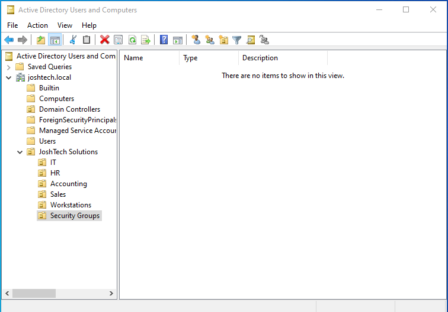
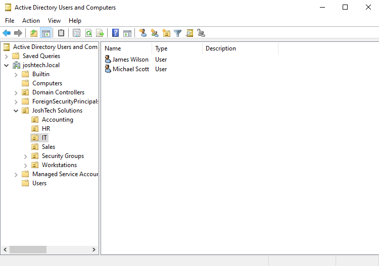
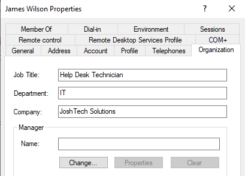
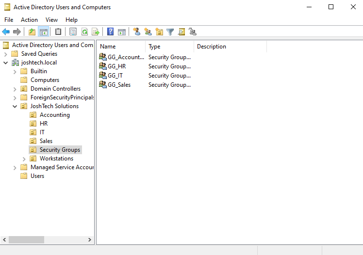
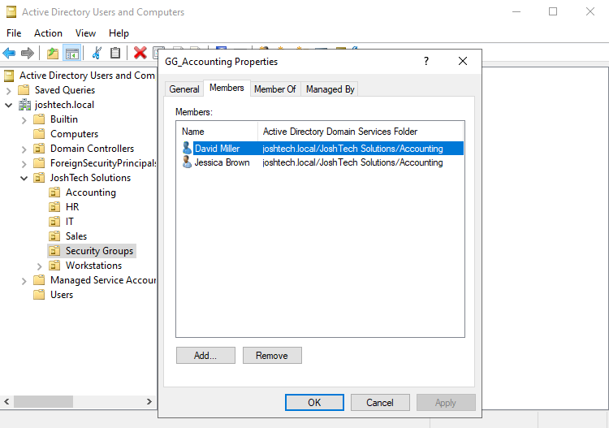

# JoshTech-Active-Directory-Lab
Hands-on Active Directory home lab using Windows Server and Windows 11 to simulate enterprise IT administration, user management, and access control.

# Active Directory - Domain Setup and User Management

This project documents an Active Directory home lab built for a simulated company, **JoshTech Solutions**. Using Windows Server 2022, I configured a domain environment and organized employee accounts into departments using Organizational Units (OUs) and security groups. The goal was to practice common IT support and Windows administration tasks in a realistic environment.

## Environments and Technologies Used

  
  

- VMware virtual machines
- Windows Server 2022
- Active Directory Domain Services (AD DS)
- Active Directory Users and Computers (ADUC)

## Operating Systems Used

- Windows Server 2022 (domain controller)
- Windows 11 (client VM used in the broader home lab)

## Lab Prerequisites

- A Windows Server 2022 virtual machine
- Active Directory Domain Services installed and a domain controller configured
- Administrative access to manage Active Directory objects

## Configuration Steps

> [!NOTE]
> Before beginning this lab, download and install VMware Workstation and obtain the Windows Server 2022 ISO file. These resources are used to create the virtual machine environment for configuring Active Directory Domain Services.
>
> - **VMware Workstation:** [Official VMware website](https://www.vmware.com/)
> - **Windows Server 2022 ISO:** [Microsoft Evaluation Center](https://www.microsoft.com/en-us/evalcenter/evaluate-windows-server-2022)
>
> The Windows Server ISO can be used to install the operating system in a VMware virtual machine. Follow the vendors' current download and licensing instructions.

### Step 1: Set Up the Active Directory Domain

I set up Active Directory Domain Services on Windows Server 2022 and configured the domain **`joshtech.local`** for my simulated organization. A domain controller provides centralized management of domain users, computers, and authentication.

*The original AD DS installation and domain controller promotion were not captured in screenshots. The following images show the configured domain in Active Directory Users and Computers.*

### Step 2: Create Organizational Units (OUs)

In Active Directory Users and Computers, I organized the domain under a parent OU named **JoshTech Solutions**. I created separate OUs for **IT, HR, Accounting, Sales, Workstations, and Security Groups**.

OUs help administrators organize objects and apply administrative settings or Group Policy to appropriate parts of the organization. An OU by itself does **not** grant access to files or other resources.

### Step 3: Create and Organize Employee Accounts

I created employee user accounts and placed them in their respective departmental OUs. The screenshot below shows **James Wilson** and **Michael Scott** in the **IT** OU.

I also updated employee account properties with organizational information. For example, James Wilson's account lists **Help Desk Technician** as the job title, **IT** as the department, and **Josh Tech Solutions** as the company.

These properties make accounts easier to identify and manage; the job title and department fields do not independently control access permissions.

### Step 4: Create Departmental Security Groups

I created departmental security groups to manage access by group membership rather than assigning permissions to each employee individually. The groups shown include **`GG_Accounting`**, **`GG_HR`**, **`GG_IT`**, and **`GG_Sales`**.

Security groups provide a scalable way to manage permissions: administrators can assign access to a group and then add or remove employees as their responsibilities change. Creating a group alone does not grant access until permissions are assigned to it.

### Step 5: Verify Accounting Group Membership

I opened the **`GG_Accounting`** group's properties and checked the **Members** tab. It shows **David Miller** and **Jessica Brown** as members, with their accounts located in the Accounting OU.

This verifies that the two accounts are listed as members of the Accounting security group. Access to a shared folder was tested separately in my file-sharing and permissions lab.

## Verification and Results

- Confirmed that the **`joshtech.local`** domain is visible in ADUC.
- Verified the departmental OU structure under **JoshTech Solutions**.
- Confirmed that IT employee accounts are present in the IT OU.
- Verified employee profile fields and departmental security groups.
- Confirmed two Accounting employees appear in the **`GG_Accounting`** group membership list.

## Skills Demonstrated

- Windows Server 2022 administration
- Active Directory Domain Services
- Organizational Unit (OU) design
- Domain user account management
- Security group creation and membership management
- Basic Active Directory configuration verification

## Key Takeaways

This lab helped me practice how IT administrators centrally organize employee accounts and manage group membership. I learned the distinction between **OUs**, which organize directory objects, and **security groups**, which can be used to assign access permissions. These are foundational tasks for help desk and systems administration roles.

---

*This repository is part of my JoshTech Solutions IT home lab portfolio. Related projects document Windows 11 domain joining, Group Policy, and shared-folder access testing separately.*
